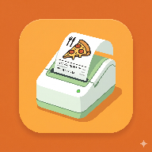
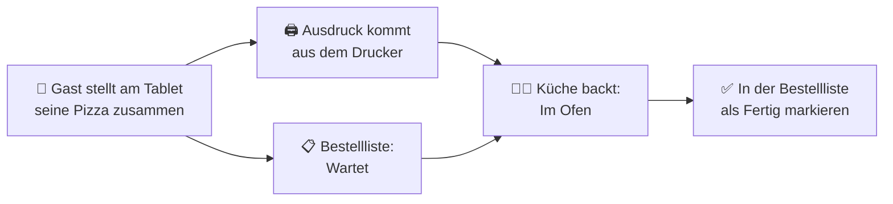

<div align="center">



# Pizza Order

**Die Bestell-App für Pizza-Abende.**<br/>
Gäste stellen am Tablet ihre Pizza zusammen, die Küche bekommt einen Ausdruck vom Bluetooth-Thermodrucker.

[](https://github.com/kaerbr/pizza-order/actions/workflows/ci.yml)
[](https://github.com/kaerbr/pizza-order/releases/latest)
[](LICENSE)


<a href="https://github.com/kaerbr/pizza-order/releases/latest"></a>

<sub>🇬🇧 German-language Android app for pizza nights: guests order on a tablet, orders print on a Bluetooth ESC/POS thermal printer.</sub>

</div>

---

## ✨ Features

- 🍕 **Vordefinierte Pizzen oder Eigenkreation**: Sauce und Beläge frei wählen
- 🥖 **Teig-Zähler**: zeigt, wie viele Pizzen noch gehen, und nimmt bei 0 keine Bestellung mehr an
- 🌱 **Vegan / Vegetarisch** wird aus den Zutaten erkannt, in der Bestellliste angezeigt und auf dem Ausdruck hervorgehoben
- ⚠️ **Allergene** (Laktose, Nüsse, Gluten, Soja) werden je Zutat im Admin-Panel gepflegt und beim Bestellen an Zutaten und Pizzen angezeigt
- 🖨️ **Ausdruck per Bluetooth** auf günstigen 58-mm-Thermodruckern, mit Bestellnummer, Name, Uhrzeit und Notiz für die Küche
- 🧾 **Bon auf dem Bildschirm**: Nach dem Bestellen läuft der Ausdruck auf dem Tablet so schnell ein wie aus dem Drucker
- 📋 **Bestellliste** mit „Wartet“, „Im Ofen“ und „Fertig“, Wartezeit und Nachdrucken; was nicht gedruckt wurde, meldet das Schnellmenü rot, auch nach einem Neustart
- 🎨 **Zwei Ausdruck-Designs**: schlichter Kassenbon oder mit Verzierung
- 📱 **Gäste bestellen wahlweise vom eigenen Handy**: QR-Code am Tablet, das Handy öffnet die Bestellseite im WLAN — ohne App, ohne Internet. Jedes Handy sieht nur die eigene Bestellung und die Warteschlange als Zahl. Der Gäste-Server dafür ist standardmäßig aus und wird im Admin-Panel eingeschaltet; ohne ihn bestellen Gäste wie gewohnt am Tablet. Siehe [Gäste bestellen vom Handy](#-gäste-bestellen-vom-handy)
- 🪧 **QR-Bon für den Tisch**: derselbe Code gedruckt, damit das Tablet in der Küche bleiben kann
- 📱 **QR-Codes** auf dem Ausdruck, z. B. zu einem Pizza-Witz
- 🌗 **Aussehen**: Hell oder Dunkel und mehrere Farbpaletten, wählbar im Schnellmenü
- 🔒 **Admin-Panel** hinter einem Entsperrmuster, damit Gäste nicht im Menü herumspielen
- ✈️ **Komplett offline**: kein Konto, kein Internet, alle Daten bleiben auf dem Tablet. Ein eingeschalteter Gäste-Server läuft auf dem Tablet selbst und ist nur im lokalen Netz erreichbar; ausgeschaltet öffnet die App keinen Port

## 🔄 So läuft ein Pizza-Abend



## 🚀 Schnellstart

1. **APK installieren:** Die neueste `pizza-order-x.y.z.apk` aus den [Releases](https://github.com/kaerbr/pizza-order/releases/latest) aufs Tablet laden und öffnen. Android fragt einmalig, ob die Installation aus dieser Quelle erlaubt ist.
2. **Drucker koppeln:** Den Thermodrucker in den Android-Bluetooth-Einstellungen mit dem Tablet koppeln.
3. **App starten** und die Berechtigung **„Geräte in der Nähe“** erlauben.
4. **Testdruck** im [Admin-Panel](#-admin-panel) auslösen. Fertig, die Gäste können bestellen.

## 🖨️ Drucker

| | |
|---|---|
| **Protokoll** | ESC/POS über Bluetooth |
| **Papierbreite** | 58 mm |
| **Getestet mit** | Munbyn IMP001 |

Die meisten günstigen Bluetooth-Bondrucker sprechen ESC/POS und sollten funktionieren.

> [!IMPORTANT]
> Die App druckt immer auf dem **ersten erreichbaren gekoppelten** Drucker. Am besten koppelst du nur einen Drucker mit dem Tablet.

## 📱 Gäste bestellen vom Handy

Der Gäste-Server ist standardmäßig **aus**. Im Admin-Panel unter „Gäste-Bestellung“ einschalten, Port setzen und den angezeigten Code auf dem Tablet lassen. Den QR-Code scannen Gäste mit der Handykamera; die Seite öffnet sich im Browser, ohne App und ohne Internet. Neben dem Code steht dieselbe Adresse als Text mit **„Kopieren“** — für Handys, deren Kamera nicht will, und für den Weg über einen Messenger.

Voraussetzung: Handy und Tablet im **selben WLAN**. Viele Gäste-WLANs trennen Geräte voneinander (Client Isolation); dann funktioniert es nicht, und das Tablet als **Hotspot** ist der Weg daran vorbei.

Der Code bleibt gültig, bis du im Admin-Panel **„Neuer Code“** drückst — auch über einen Neustart der App hinweg. Ein einmal gedruckter QR-Bon gilt also weiter, bis du ihn bewusst ersetzt; das ist gewollt, damit ein Gast nach einem Absturz weiterbestellen kann.

Was die Gäste sehen:

| | |
|---|---|
| **Menü** | Saucen, Beläge, vordefinierte Pizzen; ausverkaufte Zutaten und der Teig-Bestand kommen vom Tablet |
| **Allergene** | Buchstaben-Marken an Pizza und Zutat, darunter die Auflösung („Enthält Laktose“) — nur für Allergene, die im aktuellen Menü vorkommen |
| **Eigene Bestellung** | Nummer, Pizza und Status der eigenen Bestellung, aktualisiert sich von selbst |
| **Warteschlange** | Nur die Zahl: „Noch 2 Pizzen vor dir · 4 offene Bestellungen“ |

Ein Handy sieht **nur die eigene Bestellung**. Beim ersten Bestellen bekommt es dafür ein zufälliges Token, das der Browser speichert; der Server filtert die Antwort danach. Fremde Namen, Notizen und Pizzen gehen gar nicht erst über das WLAN — auch nicht „nur zum Ausblenden“ in der Seite.

Das Tablet sieht weiterhin alles: jede Gast-Bestellung landet in der normalen Bestellliste, mit Nummer, Name, Notiz und Ausdruck, als wäre sie am Tablet aufgenommen worden.

## 🔒 Admin-Panel

Über das Schnellmenü oben rechts öffnest du das Admin-Panel. Entsperrt wird es mit einem **„P“** als Muster, angefangen bei Punkt 4:

```
 1 ─── 2     3
 │     │
 4 ─── 5     6        4 → 5 → 2 → 1 → 7
 │
 7     8     9
```

Im Admin-Panel kannst du:

- die **beliebtesten Pizzen** des Abends sehen
- das **Menü** bearbeiten (Saucen, Beläge, vordefinierte Pizzen anlegen und ändern) oder in einer **Datei** sichern und wieder laden
- Zutaten für heute als **aus** markieren: Gäste können sie und Pizzen damit nicht mehr wählen, das Menü bleibt unverändert
- eintragen, wie viele **Teiglinge** es heute gibt (ohne Eintrag wird nicht gezählt), und den Bestand um eins korrigieren
- begrenzen, wie viele **offene Bestellungen** es gleichzeitig geben darf (ohne Eintrag kein Limit); ist das Limit erreicht, sagt die App ab, statt die Küche zu überfüllen
- den **Bildschirm fixieren**, damit Home und Zurück gesperrt sind (gegen gezieltes Lösen hilft die PIN-Abfrage in den Android-Einstellungen)
- das **Ausdruck-Design** wählen und einen **Testdruck** auslösen
- den **Gäste-Server** ein- und ausschalten (Standard: aus), den Port setzen und den Code neu erzeugen; derselbe Abschnitt zeigt den QR-Code für Gäste und druckt den **QR-Bon für den Tisch**. Ab Android 17 fragt das System einmalig nach der Berechtigung für lokale Netzwerke; ohne sie startet der Server nicht und der Abschnitt nennt den Grund
- **QR-Links zum Bon** pflegen (die Codes auf dem Küchenbon, nicht der Gäste-Zugang)
- **alle Bestellungen löschen**, z. B. vor dem nächsten Abend (der Teig-Zähler startet dabei wieder bei der Anzahl für heute, und „aus“ markierte Zutaten sind wieder da)
- **alles zurücksetzen**: Bestellungen, Menü, Teig, QR-Links und Ausdruck-Design wie nach der Installation

> Der **QR-Code für Gäste** liegt außerdem direkt im Schnellmenü (oben rechts), ohne Muster davor: er ist für Gäste gedacht, nicht für den Admin.

> [!NOTE]
> Die Sperre soll nur neugierige Gäste fernhalten und ist keine echte Sicherheit.

### Ausdruck-Designs

| Design | Beschreibung |
|---|---|
| **Beleg** | Wie ein Kassenbon: Nummer, Gast, Zeit, Positionen |
| **Beleg Design** | Wie ein Kassenbon: Nummer, Gast, Zeit, Positionen + Design |

## 🛠️ Selbst bauen

Voraussetzung ist [Android Studio](https://developer.android.com/studio). Projekt öffnen, `app` starten. Oder per Kommandozeile:

```sh
./gradlew assembleDebug
```

Vor jedem Debug-Build laufen die Unit-Tests (`./gradlew testDebugUnitTest`), damit ein ungültiges Standard-Menü nicht erst beim App-Start auffällt.

**Flüssig oder nicht?** Debug-Builds laufen spürbar ruckeliger als die Release-APK, weil sie nicht optimiert werden. Um die Geschwindigkeit zu beurteilen, `./gradlew assemblePreview` bauen: optimiert wie das Release, aber mit dem Debug-Schlüssel signiert und als eigene App „Pizza Order (Preview)“ installierbar.

**Standard-Menü anpassen:** Das Menü, mit dem die App ausgeliefert wird, steht in [`MenuConfig.kt`](app/src/main/java/io/github/kaerbr/pizzaorder/MenuConfig.kt) (`MenuConfig.Standard`). Dort ist auch für jede Zutat hinterlegt, ob sie vegan oder vegetarisch ist und welche Allergene sie enthält.

Die Begriffe, die im Projekt verwendet werden, erklärt das [Glossar](GLOSSARY.md).

## 🤝 Mitmachen

Issues und Pull Requests sind willkommen.

- Commit-Messages folgen [Conventional Commits](https://www.conventionalcommits.org/de/) (`feat:`, `fix:`, `docs:` …), denn aus ihnen entstehen Version und Changelog.
- `./gradlew assembleDebug` muss durchlaufen, die Tests laufen dabei automatisch mit.

<details>
<summary><b>📦 Releases & Signierung</b> (für Maintainer)</summary>

<br/>

Bei Pull Requests und jedem Push auf `main` lässt GitHub Actions die Unit-Tests und Android Lint laufen. Eine APK entsteht nur auf `main`, beim Release. `feat:`- und `fix:`-Commits erzeugen per [semantic-release](https://semantic-release.gitbook.io/) eine neue Version mit `CHANGELOG.md`-Eintrag und einem GitHub Release samt signierter APK. Die Version in `app/build.gradle.kts` setzt semantic-release, bitte nicht von Hand ändern.

Signiert wird mit dem Release-Keystore aus den Repo-Secrets `KEYSTORE_BASE64`, `KEYSTORE_PASSWORD`, `KEY_ALIAS` und `KEY_PASSWORD`. Lokale Builds sind davon nicht betroffen.

</details>

## 🙏 Danke

Gedruckt wird mit [ESCPOS-ThermalPrinter-Android](https://github.com/DantSu/ESCPOS-ThermalPrinter-Android) von DantSu.

## 📄 Lizenz

[MIT](LICENSE)
