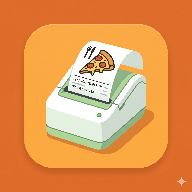
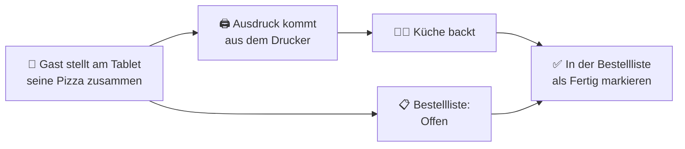

<div align="center">



# Pizza Order

**Die Bestell-App für Pizza-Abende.**<br/>
Gäste stellen am Tablet ihre Pizza zusammen, die Küche bekommt einen Ausdruck vom Bluetooth-Thermodrucker.

[](https://github.com/kaerbr/pizza-order/actions/workflows/ci.yml)
[](https://github.com/kaerbr/pizza-order/releases/latest)
[](LICENSE)


<a href="https://github.com/kaerbr/pizza-order/releases/latest"></a>

<sub>🇬🇧 German-language Android app for pizza nights: guests order on a tablet, orders print on a Bluetooth ESC/POS thermal printer.</sub>

</div>

---

## ✨ Features

- 🍕 **Vordefinierte Pizzen oder Eigenkreation**: Sauce und Beläge frei wählen
- 🥖 **Teig-Zähler**: zeigt, wie viele Pizzen noch gehen, und nimmt bei 0 keine Bestellung mehr an
- 🌱 **Vegan / Vegetarisch** wird aus den Zutaten erkannt und auf dem Ausdruck hervorgehoben
- 🖨️ **Ausdruck per Bluetooth** auf günstigen 58-mm-Thermodruckern, mit Bestellnummer, Name und Notiz für die Küche
- 📋 **Bestellliste** mit „Offen“ und „Fertig“, Wartezeit und Nachdrucken
- 🎨 **Acht Ausdruck-Designs** vom sparsamen Dreizeiler bis zum Pizza-Bild mit Rahmen
- 📱 **QR-Codes** auf dem Ausdruck, z. B. zu einem Pizza-Witz
- 🔒 **Admin-Panel** hinter einem Entsperrmuster, damit Gäste nicht im Menü herumspielen
- ✈️ **Komplett offline**: kein Konto, kein Server, alle Daten bleiben auf dem Tablet

## 🔄 So läuft ein Pizza-Abend



## 🚀 Schnellstart

1. **APK installieren:** Die neueste `pizza-order-x.y.z.apk` aus den [Releases](https://github.com/kaerbr/pizza-order/releases/latest) aufs Tablet laden und öffnen. Android fragt einmalig, ob die Installation aus dieser Quelle erlaubt ist.
2. **Drucker koppeln:** Den Thermodrucker in den Android-Bluetooth-Einstellungen mit dem Tablet koppeln.
3. **App starten** und die Berechtigung **„Geräte in der Nähe“** erlauben.
4. **Testdruck** im [Admin-Panel](#-admin-panel) auslösen. Fertig, die Gäste können bestellen.

## 🖨️ Drucker

| | |
|---|---|
| **Protokoll** | ESC/POS über Bluetooth |
| **Papierbreite** | 58 mm |
| **Getestet mit** | Munbyn IMP001 |

Die meisten günstigen Bluetooth-Bondrucker sprechen ESC/POS und sollten funktionieren.

> [!IMPORTANT]
> Die App druckt immer auf dem **ersten gekoppelten** Bluetooth-Gerät. Am besten koppelst du nur einen Drucker mit dem Tablet.

## 🔒 Admin-Panel

Über das Admin-Symbol oben rechts öffnest du das Admin-Panel. Entsperrt wird es mit einem **„P“** als Muster, angefangen bei Punkt 4:

```
 1 ─── 2     3
 │     │
 4 ─── 5     6        4 → 5 → 2 → 1 → 7
 │
 7     8     9
```

Im Admin-Panel kannst du:

- das **Menü** bearbeiten (Saucen, Beläge, vordefinierte Pizzen) oder auf das Standard-Menü zurücksetzen
- eintragen, wie viele **Teiglinge** es heute gibt (ohne Eintrag wird nicht gezählt)
- das **Ausdruck-Design** wählen und einen **Testdruck** auslösen
- **QR-Links** für den Ausdruck pflegen
- **alle Bestellungen löschen**, z. B. vor dem nächsten Abend

> [!NOTE]
> Die Sperre soll nur neugierige Gäste fernhalten und ist keine echte Sicherheit.

### Ausdruck-Designs

| Design | Beschreibung |
|---|---|
| **Beleg** | Wie ein Kassenbon: Nummer, Gast, Zeit, Positionen |
| **Beleg Design** | Wie ein Kassenbon: Nummer, Gast, Zeit, Positionen + Design |
| **Kompakt** | Drei Zeilen, spart Papier |
| **Fest** | Verspielt mit Rahmen und Pizza-Bild |
| **Nero** | Pizza-Zettel: Zutaten einzeln, große Abholnummer |
| **QR-Lacher** | Kurzer Ausdruck mit QR-Code zu einem Pizza-Witz zum Scannen |
| **Bon** | Kopf mit Doppelrahmen, Punktlinien, Ankreuzfeld und QR-Code |
| **Klassisch** | Der ursprüngliche Ausdruck mit Ofen-Bild |

## 🛠️ Selbst bauen

Voraussetzung ist [Android Studio](https://developer.android.com/studio). Projekt öffnen, `app` starten. Oder per Kommandozeile:

```sh
./gradlew assembleDebug
```

Vor jedem Debug-Build laufen die Unit-Tests (`./gradlew testDebugUnitTest`), damit ein ungültiges Standard-Menü nicht erst beim App-Start auffällt.

**Flüssig oder nicht?** Debug-Builds laufen spürbar ruckeliger als die Release-APK, weil sie nicht optimiert werden. Um die Geschwindigkeit zu beurteilen, `./gradlew assemblePreview` bauen: optimiert wie das Release, aber mit dem Debug-Schlüssel signiert und als eigene App „Pizza Order (Preview)“ installierbar. Bei Pull Requests legt CI diese APK neben die Debug-APK.

**Standard-Menü anpassen:** Das Menü, mit dem die App ausgeliefert wird, steht in [`MenuConfig.kt`](app/src/main/java/io/github/kaerbr/pizzaorder/MenuConfig.kt) (`MenuConfig.Standard`). Dort ist auch für jede Zutat hinterlegt, ob sie vegan oder vegetarisch ist.

Die Begriffe, die im Projekt verwendet werden, erklärt das [Glossar](GLOSSARY.md).

## 🤝 Mitmachen

Issues und Pull Requests sind willkommen.

- Commit-Messages folgen [Conventional Commits](https://www.conventionalcommits.org/de/) (`feat:`, `fix:`, `docs:` …), denn aus ihnen entstehen Version und Changelog.
- `./gradlew assembleDebug` muss durchlaufen, die Tests laufen dabei automatisch mit.

<details>
<summary><b>📦 Releases & Signierung</b> (für Maintainer)</summary>

<br/>

Bei jedem Push auf `main` baut und testet GitHub Actions die App. `feat:`- und `fix:`-Commits erzeugen per [semantic-release](https://semantic-release.gitbook.io/) eine neue Version mit `CHANGELOG.md`-Eintrag und einem GitHub Release samt signierter APK. Die Version in `app/build.gradle.kts` setzt semantic-release, bitte nicht von Hand ändern.

Signiert wird mit dem Release-Keystore aus den Repo-Secrets `KEYSTORE_BASE64`, `KEYSTORE_PASSWORD`, `KEY_ALIAS` und `KEY_PASSWORD`. Lokale Builds sind davon nicht betroffen.

</details>

## 🙏 Danke

Gedruckt wird mit [ESCPOS-ThermalPrinter-Android](https://github.com/DantSu/ESCPOS-ThermalPrinter-Android) von DantSu.

## 📄 Lizenz

[MIT](LICENSE)
